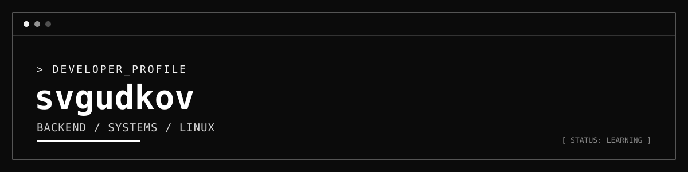

<div align="center">



# `svgudkov`

**Backend Development · Systems Programming · Linux**

`JAVA` / `SPRING BOOT` / `RUST` / `PYTHON`


- **Currently learning:** `Java`, `Spring Boot`, `Rust`, `Python`.
- **Interests:** backend development, REST APIs, databases, Linux, terminal applications.

## `> tech --list`

```text
LANGUAGES   Java · Rust · Python · SQL
BACKEND     Spring Boot · REST API
DATABASES   PostgreSQL
TOOLS       Git · Linux · NixOS
```

## `> contact`

- **GitHub:** [@svgudkov](https://github.com/svgudkov)
- **Email:** `vorgarbachakov@gmail.com`
- **Telegram / website:** `https://svgudkov.github.io/tokiyomiweb/`

---

<div align="center">

```text
[ STATUS: LEARNING ]  [ BUILDING: IN PROGRESS ]
```

<sub>Built with curiosity, a terminal, and consistent practice.</sub>

</div>
